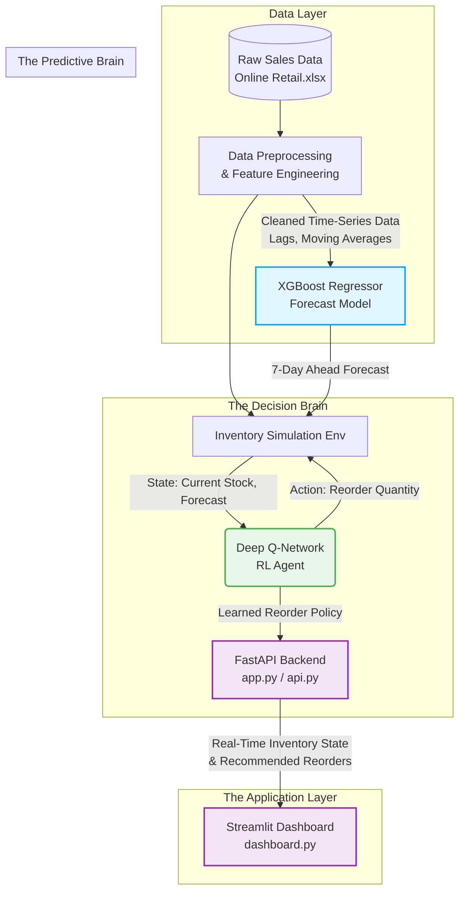

# BizChainConnect: Overall System Architecture

During your presentation, you can use the flow below to visually explain how the system parts interact with each other.

### Explaining the Flow:

1. **Data Layer**: Start with the raw e-commerce data. Explain that the crucial step is **Feature Engineering**—converting raw transactions into a format the AI can learn from (adding 25+ features like rolling averages and cyclical encoded dates).
2. **Predictive Brain**: The cleaned data is fed to the **XGBoost Regressor**, which processes complex non-linear trends to predict future demand with 98.45% accuracy.
3. **Decision Brain**: The *Forecast* from XGBoost and the *Current Inventory Level* are passed into a simulated Warehouse Environment as the **State**. The **Deep Q-Network (DQN) Agent** observes this state and takes an **Action** (deciding how much to order). Through trial and error (penalties for stockouts/holding costs), it learns the optimal policy.
4. **Application Layer**: Finally, the learned RL policy and the live XGBoost forecasts are served via a **FastAPI backend**. The end-user never sees the code—they only interact with the real-time **Streamlit Dashboard** which consumes this API to trigger visual warnings and "Suggested Order Quantities."
